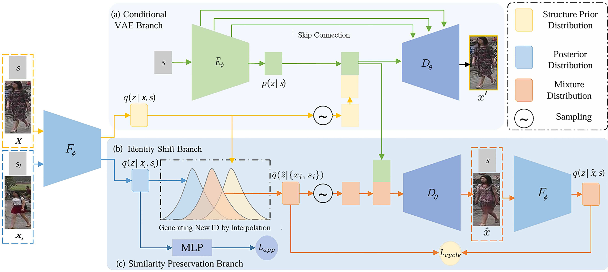

<div align="center">

# PIS · SCIS 2026

### Person identity shift for privacy-preserving person re-identification

Shuguang Dou, Xinyang Jiang, Qingsong Zhao, Yansen Wang, Dongsheng Li, Cairong Zhao

**Science China Information Sciences** · Volume 69, Issue 1, Article 112103

[**Paper**](https://doi.org/10.1007/s11432-023-4583-x) · [**Installation**](#installation) · [**Reproducing the pipeline**](#reproducing-the-pipeline) · [**Citation**](#citation)

</div>

## Overview

PIS generates identity-shifted pedestrian images by interpolating appearance representations in a conditional variational autoencoder. The source pose guides image generation, while cycle training and identity classification help preserve the learned appearance structure.

<p align="center">
  
  <br>
  <em>Figure 2 of the <a href="https://doi.org/10.1007/s11432-023-4583-x">published SCIS article</a>. Original image extracted from the official PDF.</em>
</p>

This release contains the VAE training, cycle/identity fine-tuning, attribute-based identity matching, and image-generation pipeline. The repository retains its original `2024-SCIS-PIS` name; the final article was published in **2026**.

## Installation

Use **Python 3.10** and **TensorFlow 2.10.1**. The model uses TensorFlow's `compat.v1` graph execution and Keras 2 APIs.

```bash
git clone https://github.com/Vill-Lab/2024-SCIS-PIS.git
cd 2024-SCIS-PIS
conda create -n pis python=3.10
conda activate pis
python -m pip install tensorflow==2.10.1
python -m pip install -r requirements.txt
```

For a CPU environment, install `tensorflow-cpu==2.10.1` in place of `tensorflow==2.10.1`. GPU runs need the matching CUDA/cuDNN runtime; see the [official TensorFlow 2.10 compatibility table](https://www.tensorflow.org/install/source_windows#gpu) (CUDA 11.2, cuDNN 8.1). GPU selection follows `CUDA_VISIBLE_DEVICES`.

## Reproducing the pipeline

### 1. Prepare images and pose annotations

Obtain Market1501 or DukeMTMC-ReID images and their pose annotations separately. Images, pose annotations, identity-pairing maps, and trained checkpoints are not bundled.

The input is an `index.p` pickle containing:

| Field | Format |
| :--- | :--- |
| `imgs` | Image paths relative to the index, e.g. `train/0001_c1_000001.jpg` |
| `train` | One Boolean per image: training split or test split |
| `joints` | Array of shape `[N, 18, 2]`, normalized `(x, y)` coordinates in `[0, 1]`; negative coordinates mark invalid joints |
| `joint_order` | Joint names in the same order as the coordinate array |

The required 18 joint names, in the original PIS order, are:

```text
rankle, rknee, rhip, lhip, lknee, lankle,
rwrist, relbow, rshoulder, lshoulder, lelbow, lwrist,
neck, cnose, leye, reye, lear, rear
```

The loader respects an explicitly supplied ordering. Images without valid left/right shoulders and hips are excluded. A 128 × 128 image is converted into eight normalized body crops, concatenated as a 64 × 64 × 24 tensor.

For raw narrow ReID images, first reproduce the PIS canvas preparation: resize to 64 × 128, then pad 32 pixels on each side using replicated borders. Pose coordinates must refer to this padded canvas (`x_canvas = 0.5 * x_raw + 0.25` for valid normalized points). The image-preparation tool applies both transformations:

```bash
python tools/prepare_images.py --manifest raw/manifest.json --output-dir data/market
```

Here, raw image paths are relative to `raw/manifest.json`; the output directory must be new. If images and poses already use the padded 128 × 128 canvas, skip this step. The data loader itself does not add borders.

Use a trusted existing index, or package the prepared JSON manifest with the same fields:

```bash
python tools/prepare_index.py --manifest data/market/manifest.json --output data/market/index.p
```

This tool packages existing pose annotations; it does not estimate keypoints. Image paths in the manifest are resolved relative to the output index directory. A typical layout is:

```text
data/market/
├── index.p
├── train/
│   ├── 0001_c1_000001.jpg
│   └── ...
├── test/
│   └── ...
└── matches.json
```

### 2. Train the conditional VAE

Run commands from the repository root:

```bash
python main.py --config configs/market_cvae.yaml --mode train --data-index data/market/index.p
```

This first stage optimizes perceptual reconstruction and KL losses. VGG19 ImageNet weights are downloaded by Keras on first training use. To use a local VGG19 weights file, set `vgg_weights` in the configuration.

The number of identity classes is inferred from the valid training split. Logs, the effective configuration, identity labels, reconstructed samples, and checkpoints are saved under `logs/<timestamp>/`. Use `--log-dir /path/to/outputs` to change the output root.

### 3. Fine-tune with cycle training and identity preservation

Start the second stage from the first-stage checkpoint:

```bash
python main.py --config configs/market_pis.yaml --mode train --data-index data/market/index.p --retrain --checkpoint logs/STAGE1/checkpoints/model.ckpt-100000
```

`--retrain` loads compatible model weights and resets the optimizer states and training step. To resume an interrupted run in the same stage, use its saved configuration and checkpoint without `--retrain`.

| Dataset | VAE stage | Cycle + identity stage |
| :--- | :---: | :---: |
| Market1501 | [market_cvae.yaml](configs/market_cvae.yaml) | [market_pis.yaml](configs/market_pis.yaml) |
| DukeMTMC-ReID | [duke_cvae.yaml](configs/duke_cvae.yaml) | [duke_pis.yaml](configs/duke_pis.yaml) |

The supplied configurations use 128 × 128 inputs. Adjust batch sizes and logging intervals in YAML for your hardware. Keep the data index, identity-label ordering, and model configuration consistent when resuming training.

### 4. Select partner identities

For each source identity, provide a different partner identity from the same valid data split. The generation input is a JSON object such as:

```json
{"0001": "0002", "0002": "0001"}
```

IDs must match the image filename prefixes, including leading zeros. Every valid source identity needs a valid partner. The generator uses one reference image of that partner consistently for all images of a source identity.

For Market1501, build the pairing from the [official attribute annotations](https://github.com/vana77/Market-1501_Attribute):

```bash
python tools/make_matches.py --market-attributes /path/to/market_attribute.mat --index data/market/index.p --output data/market/matches.json
```

Alternatively, pass `--attributes /path/to/attributes.json` with records such as `{"0001": {"age": 1, "hat": 0, "gender": 1}}`. The supplied matching rule selects the first identity, in valid training-index order, with a different age category, hat attribute, and gender attribute. JSON `hat`/`gender` values must be Boolean or 0/1; the official MAT 1/2 values are converted by the tool. It reports an error if no candidate satisfies the rule; a custom valid pairing can be supplied directly.

### 5. Generate identity-shifted images

```bash
python main.py --config configs/market_pis.yaml --mode mix --data-index data/market/index.p --match-file data/market/matches.json --checkpoint logs/STAGE2/checkpoints/model.ckpt-100000 --alpha 0.5
```

Generation processes complete identity groups; reduce `identities_per_batch` in YAML if the batch uses too much memory. This setting, rather than the training `batch_size`, controls the number of identities processed together.

The interpolation is `z_shift = (1 - alpha) * z_source + alpha * z_partner`, where `alpha` is in `[0, 1]`. The source pose is retained. Generation loads only the trained VAE weights and does not require VGG19 or attribute-recognition network weights.

Images are written to `logs/<timestamp>/images/`. With the default configuration, the 128 × 128 output is center-cropped to **128 × 64**, and the numeric identity prefix is increased by **1500**. Camera and image suffixes are retained. `identity_offset` controls this filename convention; it is not a separate privacy mechanism.

The pairing tool builds training-split mappings. Use `--split test` with a separately supplied pairing valid for the test split to generate that split. To inspect VAE reconstructions without identity interpolation:

```bash
python main.py --config configs/market_pis.yaml --mode recon --data-index data/market/index.p --checkpoint logs/STAGE2/checkpoints/model.ckpt-100000
```

A checkpoint argument is the TensorFlow **prefix** (`model.ckpt-N`), without `.index` or `.data-00000-of-00001`. Upstream VUNet checkpoints are not supplied or claimed to be interchangeable with PIS checkpoints.

<details>
<summary><strong>Implementation notes and validation</strong></summary>

The network and interpolation operations are curated from the supplied VUNet-based PIS source. The cycle branch is restored from its cycle-training snapshot: after the VAE/identity update, generated images are body-normalized and re-encoded, and an auxiliary encoder update minimizes latent-mean squared error. This is the supplied implementation's unit-variance cycle surrogate; its reduction and two-step optimization are not a verbatim implementation of the paper's combined KL objective. The reconstruction priors are kept separate from interpolation priors, and batch dimensions are derived from the configuration.

| Path | Purpose |
| :--- | :--- |
| [main.py](main.py) | Two-stage training, checkpoint loading, interpolation and reconstruction |
| [models.py](models.py) · [nn.py](nn.py) | VAE encoder/decoder, identity heads and TensorFlow operations |
| [deeploss.py](deeploss.py) | Frozen VGG19 perceptual loss |
| [batches.py](batches.py) | Pose normalization, dataset iteration, matching and image output |
| [tools/](tools) | Image/pose canvas preparation, index packing and attribute-based pairing |

Run the synthetic checks without research datasets or pretrained weights:

```bash
python -m pip install -r requirements-dev.txt
python -m pytest tests -q
python main.py --help
```

The checks exercise data handling, network execution, cycle fine-tuning, checkpoint restoration and image generation. They do not establish the paper's reported privacy or ReID results. Benchmark evaluation requires the corresponding real datasets, trained weights, and evaluation protocols.

</details>

## Citation

If this code is useful for your research, please cite the published article:

```bibtex
@article{Dou2026PIS,
  author = {Dou, Shuguang and Jiang, Xinyang and Zhao, Qingsong and Wang, Yansen and Li, Dongsheng and Zhao, Cairong},
  title = {Person identity shift for privacy-preserving person re-identification},
  journal = {Science China Information Sciences},
  year = {2026},
  volume = {69},
  number = {1},
  pages = {112103},
  doi = {10.1007/s11432-023-4583-x},
  url = {https://doi.org/10.1007/s11432-023-4583-x}
}
```

## Acknowledgments

The generative backbone and pose-processing code build on [VUNet](https://github.com/CompVis/vunet), with neural-network utilities derived from [PixelCNN++](https://github.com/openai/pixel-cnn). We also acknowledge the [Market1501 attribute annotations](https://github.com/vana77/Market-1501_Attribute).

See [LICENSE](LICENSE) and [THIRD_PARTY_NOTICES.md](THIRD_PARTY_NOTICES.md) for project and upstream attribution. The paper figure retains its original publication attribution.